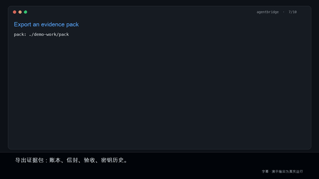

# agentbridge

**The delivery-evidence layer for Agent collaboration.** A zero-dependency Python library + CLI that lets two agents (or two processes acting for them) exchange work, then prove to a third party **which version was delivered to whom, whether it was accepted, and whether the record was altered**.

[](https://github.com/wyjtopsc-ctrl/agentbridge/actions/workflows/ci.yml)
[](LICENSE)
[](pyproject.toml)

[English](README.md) | [中文](README.zh-CN.md)



[▶ 2-minute demo video (MP4)](demo/agentbridge-demo-zh.mp4) · [storyboard + narration](demo/DEMO.md) · [narration text](demo/narration.md)

> Status: **0.9.3**, pre-1.0, evidence-pack **v0.2 (technical freeze)**. Local CI only; no third-party
> audit, no customer payment validation, and not a security certification. Default `hashes_only`:
> the verifier checks delivery digests and signing records, **not file contents**.

## Why

When AI agents hand work to each other, the hard part is not making them talk. It is proving
afterwards what actually happened: which version was delivered, what the receiver accepted, and
whether the record was quietly edited. Logs can be rewritten, chat can be redacted, and the
platform is often a party to the transaction.

agentbridge does not try to be the authority. It gives both sides a shared, tamper-evident record
and gives the **human** an anchor to hold outside the machine. It does not adjudicate quality or
blame; it fixes “promise → delivery → acceptance” into verifiable facts and states what it cannot
prove.

## What it gives you

| Capability | What it provides |
|---|---|
| Hash-chained ledger | `seq/prev/digest` continuity; mid-chain edits and tail truncation are detectable; appends fail closed |
| Envelopes & artifacts | signed requests/deliveries; attachments stored by sha256 and verified against the stored copy |
| Identity | Ed25519, actor registry, key rotation/revocation, per-record key selection from the ledger timeline |
| Delivery & acceptance | logical delivery + version + revision chain; acceptance binds version and artifact hash set |
| Evidence pack v0.2 | verbatim ledger slice, envelopes, acceptances, key history and anchor receipts; signed manifest |
| Offline verifier | six axes: integrity / identity / acceptance / coverage / anchoring / content; reason codes and disclosure |
| Integrations | CLI, Python API, MCP stdio, HTTP single-writer sequencer, hosted anchor service |

## Install

```console
python3 -m venv .venv && . .venv/bin/activate
pip install -e .            # from source; no runtime dependencies
agentbridge --help
```

Python 3.9+, POSIX (uses `fcntl`). Wheels/sdists are attached to GitHub releases.

## Quick start

```console
$ mkdir -p keys shared
$ agentbridge keygen --actor client --out keys
$ agentbridge keygen --actor worker --out keys
$ agentbridge --root shared init --actor client
$ agentbridge --root shared --key keys/client.key register
$ agentbridge --root shared --key keys/worker.key register

$ agentbridge --root shared --key keys/client.key \
    send --to worker --intent review --body "review this module" --attach ./module.py
$ agentbridge --root shared --key keys/worker.key \
    deliver --to client --in-reply-to <id> --body "delivered v1" --attach ./findings.md
```

Acceptance is currently recorded through the Python API:

```python
from agentbridge import Bridge

b = Bridge("shared")
b.accept_delivery("client", "<delivery envelope id>", version="v1",
                  decision="accepted", reason="")
```

Revision + re-acceptance: `deliver --version v2 --revises <v1 id>`, then accept v2 separately.
Accepting v1 never implies accepting v2.

## Evidence pack: export and verify offline

```console
$ agentbridge --root shared --key keys/exporter.key \
    evidence export --delivery <v2 id> --out ./pack \
    --status ./status.json --receipt ./receipt.json \
    --task-system jira --task-id ABC-123

$ agentbridge evidence verify --pack ./pack --trust ./trust.json
```

The verifier prints six axes, reason codes and a `disclosure` line (e.g. content was not reviewed
in `hashes_only` mode). The trust file must live outside the pack and be independently confirmed by
the receiver. Exit codes: `0` all pass, `1` any fail, `2` unknown/not-executed, `3` protocol error.

## Design in thirty seconds

- **Envelope** — one JSON file per message in `wire/outbox` (requests) or `wire/inbox` (deliveries),
  carrying signatures and an artifact list.
- **Artifact store** — every attachment is copied to `wire/artifacts/<sha256>`; verification runs
  against that copy, so editing the original only shows up as `drifted`.
- **Ledger** — `ledger.jsonl`, append-only hash chain; `wire/head.json` holds the tip and appends are
  fail-closed if the tip does not match.
- **External anchor** — `agentbridge anchor` prints `(seq, digest)` for a human to keep off-machine;
  this is the only defence against a coordinated rewrite of ledger + head.
- **Key timeline** — register/rotate/revoke events are bound to ledger positions and digests;
  a revoked key cannot authorize another rotation.
- **Revisions** — one `delivery_id` can have multiple versions; superseded versions are flagged,
  but their signatures and bindings are still fully verified.

## Tests

```console
make ci     # 9 suites + protocol matrix + rebuild determinism + schema + fuzz + independent crosscheck
```

Schema validation needs Node + Ajv (`npm install --prefix tools`); the independent crypto
crosscheck needs Python `cryptography`. Missing tools are reported as SKIP, never PASS.

Current local results: 109/109 product tests, 17/17 protocol matrix, 11/11 independent crosscheck,
300/300 malformed-pack fuzz, 101/101 byte-identical rebuild.

## Known limits

- `hashes_only`: file contents are not reviewed; a valid signature does not mean correct content.
- K3 emergency recovery is not implemented; key loss/compromise uses a documented manual process.
- An unanchored tail rollback is undetectable by design; offline verification cannot confirm
  “latest full history”.
- Export takes a shared ledger lock and blocks writers, but crashes, full disks and cross-host
  replication are not covered.
- Multi-task batch export, project isolation, retention and encryption are not implemented.

## Documentation

- [Tutorials](docs/tutorials/README.md): MCP, LangGraph, CrewAI
- [2-minute dispute demo](demo/DEMO.md): reject → revise → accept → verify → tamper
- [Launch kit](docs/launch/README.md): Show HN / Reddit / V2EX / X copy

- [Protocol](docs/protocol.md) · [Threat model](docs/threat-model.md) · [MCP](docs/mcp.md)
- [Evidence-pack v0.2](docs/evidence-pack-v0.2.md) · [schema](docs/evidence-pack-v0.2.schema.json)
- [Freeze record](docs/freeze-record-2026-10-21.md) · [Version history](docs/version-history.md)
- Whitepaper / manual / version history PDFs: `docs/exports/`

## License

MIT — see [LICENSE](LICENSE). Copyright (c) 2026 Yongjie Wang (王永杰, carlwang).
